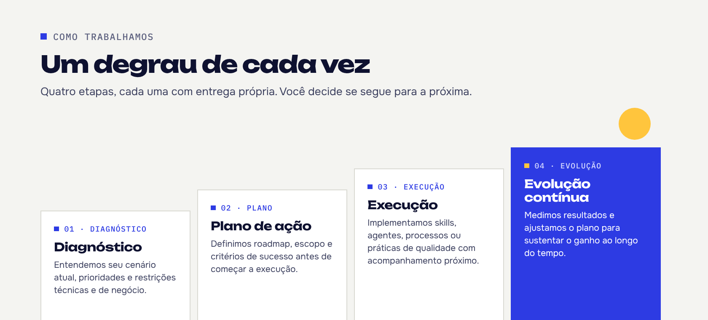

 

A **LOM Consultoria** ajuda pequenas e médias empresas a transformar tecnologia em resultado, sem a complexidade e o custo de uma consultoria pensada para grandes corporações.

São mais de 20 anos de experiência prática em TI e qualidade de software, hoje aplicados também a IA generativa e agentes: organizamos prioridades de tecnologia, colocamos skills e agentes de IA para funcionar no dia a dia e melhoramos processos sem complicar o que já dá certo.

### O que fazemos

| | Serviço | Na prática |
|:--|:--|:--|
| `S-01` | **Consultoria em TI** | Diagnóstico, roadmap e governança para organizar prioridades e reduzir riscos técnicos. |
| `S-02` | **Construção de Skills** | Skills, instruções e padrões reutilizáveis para times que usam IA generativa e agentic no dia a dia. |
| `S-03` | **Agentes de IA** | Desenho, implementação, automações e integrações de agentes aplicados ao seu processo. |
| `S-04` | **Qualidade de Software** | Estratégia de testes, métricas e automação para o seu time, com IA apoiando as boas práticas de qualidade. |

Cada serviço pode ser contratado separado ou combinado em um acompanhamento contínuo, dependendo de onde a sua operação está hoje. Detalhes em [lomconsultoria.com/servicos](https://lomconsultoria.com/servicos.html).

 

<picture>
  <source media="(prefers-color-scheme: dark)" srcset="https://raw.githubusercontent.com/lomconsultoria/.github/main/profile/lom-github-degraus-dark.png">
  
</picture>

### Por aqui no GitHub

Os projetos da LOM seguem o mesmo padrão de qualidade que levamos aos clientes: casos de teste em BDD escritos em português, verificação de acessibilidade (WCAG 2.2 AA) e de segurança (OWASP) a cada mudança, e só versão testada vai para produção.

### Próximo degrau

Quer entender por onde começar? Fale com a gente e receba um diagnóstico inicial sobre onde vale mais a pena focar primeiro.

**[Solicitar diagnóstico →](https://lomconsultoria.com/contato.html)**

[lomconsultoria.com](https://lomconsultoria.com) · [contato@lomconsultoria.com](mailto:contato@lomconsultoria.com) · [Instagram @lomconsultoria](https://www.instagram.com/lomconsultoria/)

LOM Consultoria · Porto Alegre, RS
